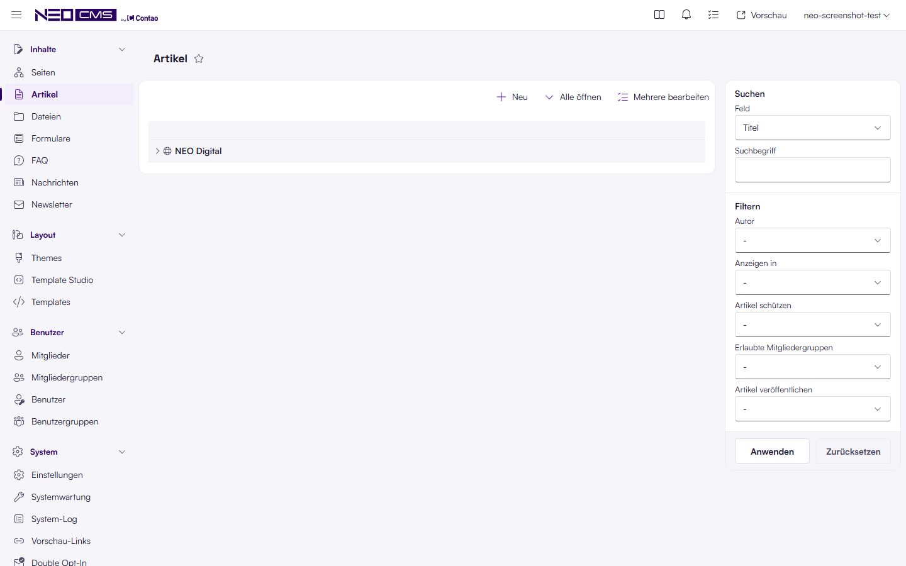
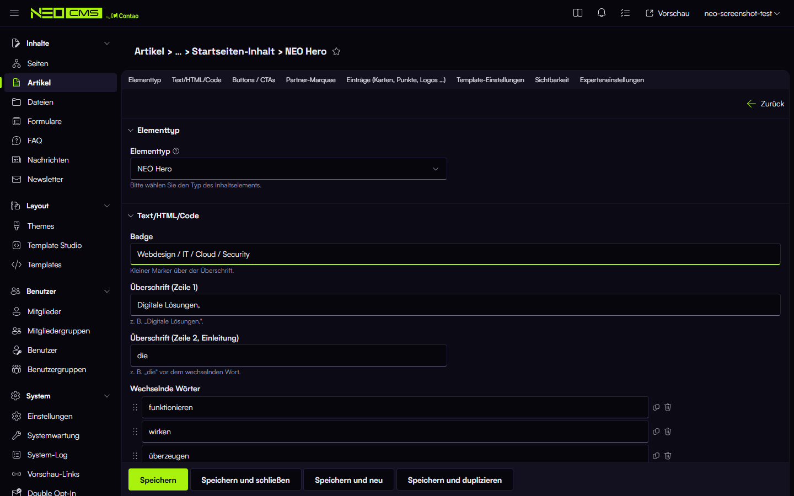

# NEOcms by Contao — `neo/neocms-bundle`

NEO Digital's back end look for Contao 5: the Contao back end becomes **NEOcms by Contao**,
styled like the NEO webmail skin for Roundcube (Outlook-style layout, Microsoft Fluent
icons, NEO colours and fonts) — and links from the back end to the front end point to
the website's main domain, even when the back end runs on its own sub domain.

Editing works exactly as in Contao. Only the look changes; no database tables, no
migrations, nothing to configure for the look itself.

| Light | Dark |
|---|---|
|  |  |

## What it does

- NEOcms logo (violet in light mode, neon green in dark mode), 48 px header, content as a
  card on a grey canvas, Satoshi / Space Grotesk.
- Sidebar with a Fluent icon per module; areas collapse/expand (chevron); the whole
  sidebar collapses to an icon rail (button in the header).
- Microsoft Fluent UI System Icons instead of Contao's icons.
- Fluent fields (40 px, 4 px radius, accent underline on focus), switches instead of form
  checkboxes, Fluent dropdowns, NEO status colours, no shadows.
- Login page with centred NEOcms logo.
- "Zum Frontend", "Vorschau" and shareable preview links on the main domain.

## Requirements

- Contao **5.7** (Managed Edition), PHP **8.2+**
- For the front end links on a separate admin domain: a domain name on the website root
  and two server addresses — see [installation](docs/en/installation.md).

## Installation (short)

```bash
composer require neo/neocms-bundle
```

…or upload `neo-neocms-bundle-<version>.zip` in the Contao Manager ("Upload packages").
Details, private repository setup and server notes: [docs/en/installation.md](docs/en/installation.md).

## Documentation

- English: [docs/en/README.md](docs/en/README.md)
- Deutsch: [docs/de/README.md](docs/de/README.md)

## Licence

Proprietary — for NEO Digital and its clients, see [LICENSE](LICENSE). Bundled icons and
fonts: [THIRD-PARTY.md](THIRD-PARTY.md).
